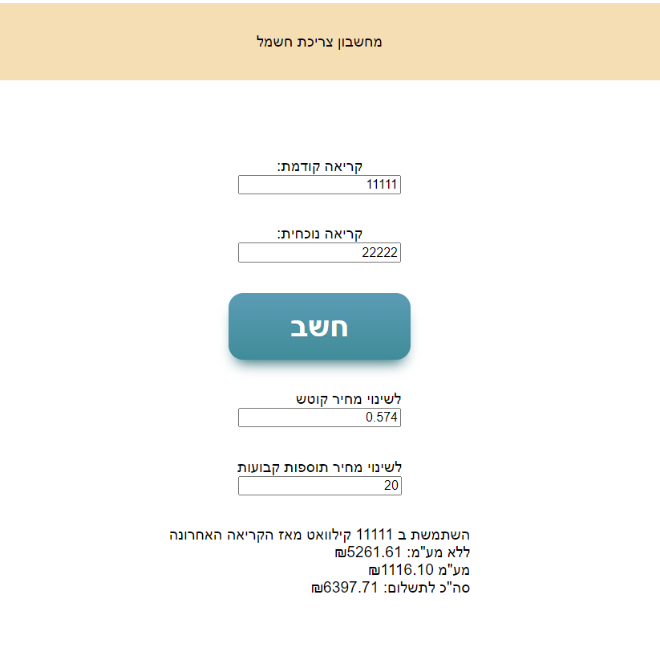

# Electricity Bill Calculator

A React app that calculates the electricity bill from two meter readings.

**[▶ Try the live demo](https://avraham186.github.io/Electricity-calc/)**

## Features

- Calculates usage in kWh from the previous and current meter readings
- Adjustable price per kWh and fixed monthly charges
- Shows the cost before VAT, the VAT amount and the total to pay
- Hebrew, right-to-left interface

## Tech

- React
- Deployed to GitHub Pages

> This branch holds the production build that GitHub Pages serves.
